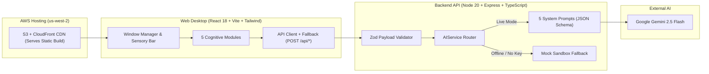

# CogOS

CogOS is a web desktop built to help neurodivergent employees get through their first 90 days at a new job and stay there. We built it for the North American AI Challenge for Neurodiverse Learning (ASU Spark Center, Mostla, and Kairós Inclusión).

https://github.com/user-attachments/assets/2200499d-7387-470e-8421-375ff7ac484c

**Live:** https://d2u8pzftovww2k.cloudfront.net

Normally, standard office tools ask the employee to mask and adapt. Instead, CogOS removes the friction between how an autistic, ADHD, or dyslexic brain works and how a corporate team operates. It is as simple as opening it in your personal browser, and it works like a calm desktop workspace with multiple key functionalities. Furthermore, it provides accessibility settings such as color themes, an OpenDyslexic-style reading font, text scaling, and screen motion removal. All of these settings and data stay in one's browser storage exclusively.

CogOS does not ask for a medical diagnosis. Output documents leave out clinical labels by design.

---

## The 5 AI Pipelines

The backend is built using five specialized prompt pipelines on Google Gemini 2.5 Flash (`@google/genai`), with Zod validation on incoming requests and deterministic fallback responses for offline deployment.

### 1. Accommodation Engine (`PASSPORT_SYSTEM_PROMPT`)
* **Endpoint:** `POST /api/passport/generate`
* **Source:** `backend/src/prompts/passportPrompt.ts`
* **The problem:** Autistic and ADHD employees struggle to ask for workplace adjustments because they do not want to sound vulnerable or hand over private medical history to HR.
* **AI integration:** You enter how you work best and what throws you off, such as "open-office noise drains me" or "surprise meetings freeze me up." The prompt translates those personal notes into a formal reasonable accommodation agreement written in standard operations language for HR and managers. It frames each request around work ergonomics and output, preserving complete medical and personal privacy.

### 2. Executive Function De-Paralyzer (`UNBLOCKER_SYSTEM_PROMPT`)
* **Endpoint:** `POST /api/unblocker/breakdown`
* **Source:** `backend/src/prompts/unblockerPrompt.ts`
* **The problem:** Vague instructions like "put together the leadership analysis" might trigger task paralysis when you cannot see the finish line or the first step to reach the goal.
* **AI integration:** You paste the ambiguous assignment and how many minutes you have. The pipeline returns two concrete tools:
  1. **Definition of Done (DoD):** A clear checklist of observable criteria so you know the exact moment the task is finished.
  2. **2 to 5 Minute Micro-Steps:** A short sequence of small actions, starting with a low-friction starter kit (like creating the blank file and pasting three headers) to break the key initial freeze.

### 3. Corporate Tone & Anxiety Neutralizer (`DECODER_SYSTEM_PROMPT`)
* **Endpoint:** `POST /api/decoder/analyze`
* **Source:** `backend/src/prompts/decoderPrompt.ts`
* **The problem:** Rejection Sensitive Dysphoria (RSD) turns short Slack or Teams messages like "can we talk at 4pm?" into panic that you are about to get fired.
* **AI integration:** You paste the message, the channel, and the sender's role (Manager, Director, or Peer). The pipeline runs a statistical reality check, reminding you that 85% of brief calendar pings are routine status checks or workload updates written in a hurry. It separates rushed corporate brevity from hostility, then drafts three professional replies calibrated to the sender's role: asking for context, acknowledging receipt, or checking on timing.

### 4. Crisis Breaker & Somatic Reset (`CRISIS_SYSTEM_PROMPT`)
* **Endpoint:** `POST /api/crisis/pause`
* **Source:** `backend/src/prompts/crisisPrompt.ts`
* **The problem:** Open offices and back-to-back calls cause sensory overload, shutdowns, and meltdowns. Stepping away feels risky when teams expect fast replies on Slack.
* **AI integration:** You pick your overload level and how long you need (for example, 20 minutes). The pipeline walks you through a 5-4-3-2-1 somatosensory grounding exercise and breathing pace you can do at your desk. At the same time, it writes a short, professional status note for Slack or Teams ("in async focus mode for 20 minutes, back at 3:40 PM") that buys you breathing room without sharing health details.

### 5. Company Culture & Onboarding Navigator (`NAVIGATOR_SYSTEM_PROMPT`)
* **Endpoint:** `POST /api/navigator/query`
* **Source:** `backend/src/prompts/navigatorPrompt.ts`
* **The problem:** Over 70% of first-quarter job loss for neurodivergent hires comes from bumping into unwritten office rules that onboarding manuals leave out.
* **AI integration:** This module works as a cultural RAG assistant. You ask an honest onboarding question, like whether you can turn your camera off on Zoom or how to ask for feedback without looking lost. The pipeline puts the literal HR handbook policy side by side with the real social norm on the team, gives you an action plan, and writes a safe copy-paste script you can use right away.

---

## System Architecture



### Repository Layout

```text
CogOS/
├── backend/                  # Express + TypeScript API server (port 3001)
│   ├── src/
│   │   ├── prompts/          # The 5 system prompt definitions
│   │   ├── routes/           # Express route handlers + Zod validation
│   │   ├── services/         # Gemini 2.5 Flash client + mock fallback data
│   │   ├── types/            # Request/response TypeScript interfaces
│   │   ├── config.ts         # Environment and mode configuration
│   │   └── index.ts          # App entry point
│   └── test/
│       └── api.test.ts       # Integration tests for all 5 endpoints + health
├── web/                      # React 18 + Vite + Tailwind web desktop (port 5173)
│   └── src/
│       ├── components/       # Desktop shell, Dock, TopBar, Window manager, and 5 modules
│       ├── context/          # SensoryContext (themes, fonts, motion) & WindowContext
│       ├── services/         # API client with automatic offline fallback
│       └── types/            # Frontend module types
├── infra/                    # AWS CloudFormation templates and lifecycle script
│   ├── cogos.sh              # One-command stack provisioning and teardown
│   ├── deploy-role.yml       # GitHub OIDC IAM role for keyless deploys
│   └── web.yml               # S3 bucket + CloudFront distribution stack
└── .github/workflows/        # GitHub Actions CI/CD pipelines
    ├── deploy.yml            # Manual dispatch workflow
    └── static-site.yml       # Reusable build, S3 sync, and CDN invalidation workflow
```

### Dual-Mode Reliability (Live Gemini + Zero-Failure Sandbox)

Demos break if conference Wi-Fi drops or API quotas run out. Due to this, we built two safety nets into CogOS:
1. **Backend Mock Sandbox:** Leave `GEMINI_API_KEY` blank in `backend/.env` and the server boots in Mock Sandbox mode. All five endpoints return structured, realistic responses matching the exact JSON schema of live Gemini calls.
2. **Frontend Offline Fallback:** If the backend server is unreachable, `web/src/services/api.ts` catches the network error and serves labeled sample data in the UI so the desktop stays usable.

---

## Local Development Guide

### Prerequisites
* **Node.js:** v20 or newer
* **npm:** v10 or newer
* **Google Gemini API Key:** Optional. Get one from Google AI Studio if you want live generation, or skip it to test with the built-in sandbox data.

### 1. Clone the repository

```bash
git clone https://github.com/LEIA-qro/CogOS-app.git
cd CogOS
```

### 2. Start the Backend API (`http://localhost:3001`)

Open a terminal and set up the Express server:

```bash
cd backend
npm install
cp .env.example .env
```

Open `backend/.env` and add your Gemini key if you want live AI responses:

```env
PORT=3001
HOST=0.0.0.0
GEMINI_API_KEY=your_gemini_api_key_here
NODE_ENV=development
```

Run the backend test suite and start the dev server:

```bash
npm test
npm run dev
```

You can verify the server status by visiting `http://localhost:3001/api/health`. The JSON response tells you if the server is running in `live` or `mock` mode.

### 3. Start the Web Desktop (`http://localhost:5173`)

Open a second terminal for the React frontend:

```bash
cd web
npm install
npm run dev
```

Open `http://localhost:5173` in your browser. By default, the frontend talks to `http://localhost:3001`. To point it at a remote backend, set `VITE_API_URL` in `web/.env` before running `npm run dev`.

---

## CloudFront & S3 Deployment Guide

We host the web desktop on AWS S3 and CloudFront in `us-west-2`. CloudFormation provisions the resources and GitHub Actions deploys the build through keyless GitHub OIDC authentication. The repository stores zero AWS access keys.

### 1. Provision AWS Infrastructure (`infra/cogos.sh`)

To create the S3 bucket, CloudFront distribution, and GitHub OIDC IAM role from your terminal, you need the AWS CLI configured with a profile (defaults to `awsedu`) and the GitHub CLI (`gh`) logged in with admin access to the repo.

```bash
# Check current CloudFormation stack status and outputs
./infra/cogos.sh status

# Deploy both stacks (cogos-web and cogos-deploy-role) and sync GitHub repo variables
./infra/cogos.sh up

# Empty the S3 bucket, delete both CloudFormation stacks, and clean up repo variables
./infra/cogos.sh down
```

Running `./infra/cogos.sh up` deploys two CloudFormation templates (`infra/web.yml` and `infra/deploy-role.yml`) and writes the stack outputs to your GitHub repository variables (`AWS_ROLE_ARN`, `AWS_REGION`, `WEB_BUCKET`, `WEB_DISTRIBUTION_ID`, and `WEB_URL`). You can override defaults with environment variables: `AWS_PROFILE`, `AWS_REGION`, `GITHUB_REPO`, or `PROJECT`.

### 2. Trigger a Deployment on GitHub Actions

You trigger deploys by hand from GitHub:
1. Go to **Actions** -> **Deploy** -> **Run workflow**.
2. Pick your branch and select the `web` target.
3. The workflow runs `.github/workflows/static-site.yml`. That job installs Node 20, builds `web/` into `web/dist`, syncs assets to S3 (with immutable caching on hashed assets and `no-cache` on `index.html`), and invalidates the CloudFront distribution.
4. Once finished, the job summary prints the live CloudFront URL (also saved in the `WEB_URL` repository variable).

### Repository Variables Reference

Configure these under **Settings** -> **Secrets and variables** -> **Actions** -> **Variables**:

| Variable | Default / Source | Purpose |
|---|---|---|
| `WEB_DIR` | `web` | Folder that the workflow builds |
| `WEB_BUILD_CMD` | `npm run build` | Build command that runs in `WEB_DIR` |
| `WEB_OUT_DIR` | `dist` | Output folder uploaded to S3 (`out` for Next static export, `build` for CRA) |
| `NODE_VERSION` | `20` | Node.js version used in CI |
| `API_URL` | Optional | Passed to the build as `VITE_API_URL` and `NEXT_PUBLIC_API_URL` |
| `AWS_ROLE_ARN` | `cogos.sh up` | IAM role for GitHub OIDC login |
| `AWS_REGION` | `cogos.sh up` | Target AWS region (`us-west-2`) |
| `WEB_BUCKET` | `cogos.sh up` | S3 bucket name for static files |
| `WEB_DISTRIBUTION_ID` | `cogos.sh up` | CloudFront distribution ID to invalidate |
| `WEB_URL` | `cogos.sh up` | Public CloudFront URL |

---
## Team Overfitters
* **Diego Alberto Pasaye González**
* **Diego Perea León**
* **Felipe Pacheco Zamorano**
* **Lizeth Landín Vega**
* **Santiago Saldaña Subías**
---
## License
MIT. See [LICENSE](LICENSE) for details.

